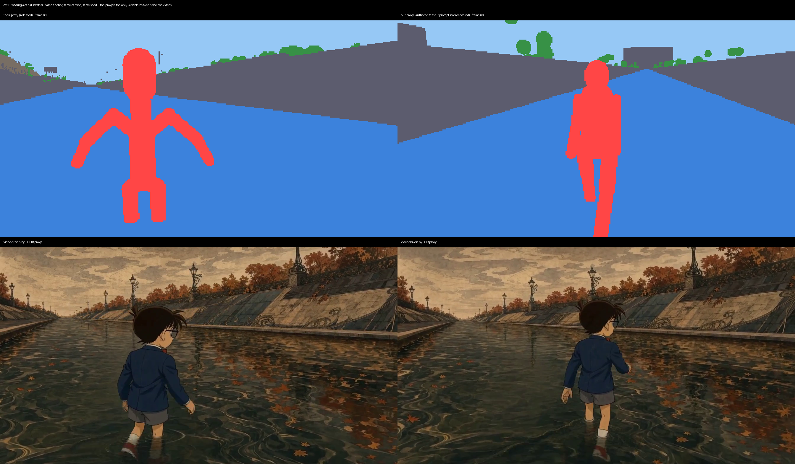
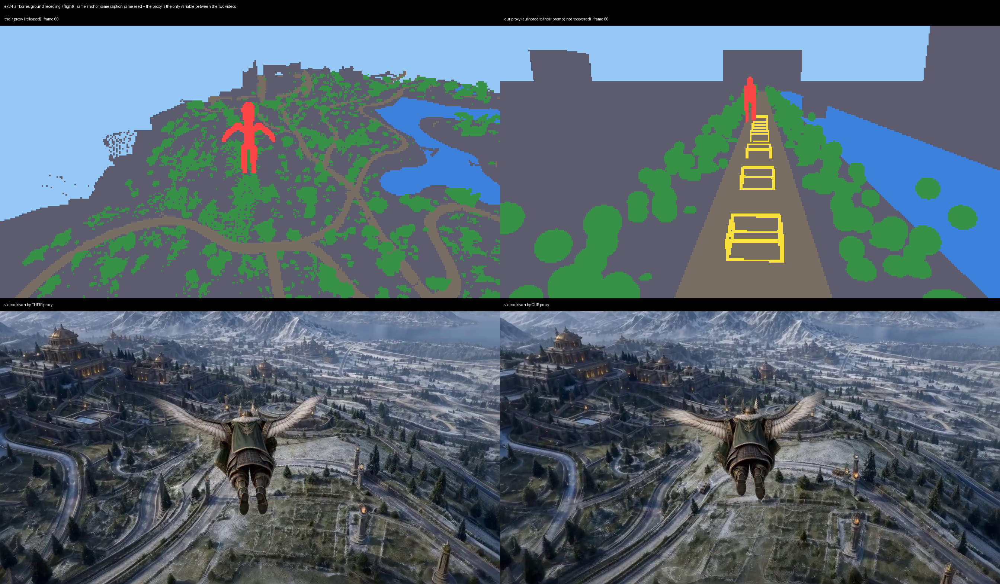

# cwm-proxy

**The open proxy generator for Code World Model — the half that wasn't released.**

[Code World Model](https://github.com/buaacyw/code-world-model) (Chen, Lin & Zhang, arXiv 2608.25927)
drives a video model with a *proxy*: a per-frame stream of metric depth and semantic-class maps,
authored by a coding agent, that tells the model where everything is. The paper releases the
inference code, the CWM LoRA, and 40 example proxies. It does not release the thing that
*makes* proxies.

This repository is an independent implementation of that missing half: a scripted world
simulator and CPU ray tracer that compile a scene into conditions in the released format,
which MiniMax-H3 accepts unmodified.

**A 484-frame take in about 25 seconds, on CPU, in NumPy. No weights, no GPU, no CUDA.**

---

## What this is, and what it is not

This project can produce **proxy conditions in the released format, at the released camera
intrinsics**. It is *not* a reconstruction of the authors' scenes.

We tried to establish the stronger claim and could not. We built an inverse renderer, recovered
their camera, unprojected their depth maps to metric point clouds, and fitted our primitives to
the result. Their water surface is exactly a plane and their road is a plane to within 1.4%, so
those two invert cleanly. Everything else does not: a single-frame *self-fit* with roughly a
thousand free parameters lands at 2.47% median depth error but 13.3% at p90, with human IoU 0.62
and vegetation IoU 0.50. Their content is film-grade mesh; our primitives approximate its visible
surface and nothing more.

The cleanest way to state the gap: on a frame where the camera is stationary, re-rendering
*their own* recovered point cloud costs 0.03% depth error, and re-rendering our fitted primitive
scene costs 0.60%. **Our primitives are about 20× worse than perfect geometry at the same
camera.** That is the honest size of the difference between a primitive proxy and film-grade mesh.

So: **conditions in their format, not reconstructions of their scenes.** The measurements behind
that sentence are in [`inverse/FINDINGS_inverse_probe.md`](inverse/FINDINGS_inverse_probe.md),
including the methods that were tried and retired — a plane-fit focal estimator that is
analytically degenerate, a vegetation lobe-count sweep that fails on its own control, and
primitive ranking from a single view, which scores `Plane` as the best model of a human body.

---

## Quick start

```bash
git clone https://github.com/<you>/cwm-proxy && cd cwm-proxy
pip install numpy pillow          # everything below needs only these two
python take_actions.py out/my_take
```

That writes `out/my_take/conditions/` (484 frames of `*.depth.f32` + `*.semantic_id.png`) and
`out/my_take/prompts/` (one caption per 124-frame window), and checks the invariants and the
captions as it goes.

It takes about 25 seconds. Note that throwing cores at it does not help — measured on one take,
8 workers 24 s, 32 workers 28 s, 100 workers 42 s, 200 workers 75 s. The ray tracing is not the
bottleneck; the serial simulation ahead of it is. Set `CWM_WORKERS` accordingly.

```bash
python validate_conditions.py out/my_take/conditions   # independent cold re-read
python test_actions.py                                 # 11 scenario tests
python test_cull.py                                    # renderer invariants
```

(The one exception is `adherence_sheet.py`, which overlays proxy class boxes on rendered video
and needs PyAV. Nothing on the path above imports it.)

---

## The condition format

Each frame is metric depth plus a semantic class id, rendered at 672×384 and pooled 2×2 to
336×192.

| field | value |
|---|---|
| resolution | 336×192, from 672×384 |
| depth | float32, metres, **first surface**, 0 = no hit |
| near / far | 0.3 m / 256 m |
| focal length | **206.6 px** at 336×192 |
| semantic ids | `{0, 1, 2, 4, 5, 8, 9, 10}` |

The focal length is measured, not assumed. (206 px is also exactly a 50.0° vertical field of
view: 96/tan 25° = 205.87. Offered as a hypothesis about where the number came from, not a
finding.) Pitch and camera height are **not** fixed: they vary per example and within a take —
camera height ranges from 1.6 m to 231 m across the 40, and one example's horizon moves 100 rows
in 124 frames. There is no single rig to recover.

**A known inconsistency:** `Camera.focal_px` defaults to 206.0, but the bundled street scene
(`StreetSpec.focal_px`) ships at 202.0, so our own takes — including the comparison figures below
— render at 202. Both sit inside the measured IQR, but if you are matching the released format
exactly, set it to 206. We recovered it from the released depth maps with an
estimator validated against known-answer synthetic data before use, cross-checked by a second
independent mechanism: **206.6 px, IQR [204, 207] across 97 estimates.**

### The semantic vocabulary is smaller than the ontology

The ontology has 12 ids. Across all 40 released examples, **only eight ever appear**:

| id | meaning | share of pixels | examples using it |
|---|---|---|---|
| 0 | everything not otherwise classed | 56.5% | 40/40 |
| 1 | sky, and "no hit" | 14.3% | 40/40 |
| 2 | water | 6.1% | 23/40 |
| 4 | road | 8.5% | 36/40 |
| 5 | vegetation | 8.4% | 40/40 |
| 8 | **the protagonist** | 3.2% | 40/40 |
| 9 | animal | 0.003% | 29/40 |
| 10 | vehicle | 2.9% | 30/40 |

Ids 3, 6, 7 and 11 appear in none of them.

Class 0 is worth a warning: it is **not** a ground plane. It is a catch-all for everything not
otherwise classed, and its planarity across examples runs from 1.2% to 55%. Their road *is* a
plane, but it is not the class-0 plane — measured tilt 1.4°–70.9° and offset 0.5–16.6 m between
the two. Modelling road as a quad lying on a shared class-0 ground plane is wrong. `RELEASED_CLASSES` in `world/state.py` declares this
set and a test fails any take that emits outside it.

**Class 8 is not "human" — it is "the protagonist."** In example 31 the protagonist is a white
stag and it is class 8, while class 9 sits at 0.02%. That is why class 9 is nearly empty in the
released data: when an animal is the subject, it takes 8.

### There are two condition families, not one

This matters if you parse the released examples, and it is not documented anywhere we could find:

| family | examples | depth encoding | depth pooling | semantic pooling |
|---|---|---|---|---|
| metric | 1, 2, 28–40 (15) | float32 metres, first surface | min positive depth 2×2 | copy |
| gray16 | 3–27 (25) | uint16 fixed-log codes **stored in a float32 array** | box mean 2×2, in log space | categorical mode 2×2 |

The gray16 family decodes as `z = 0.3 * (256/0.3) ** (1 - v/65535)` — near is *white*. Read it
as linear disparity and roads span 1.5–7282 m; read it near-black and flat-plane error is
10.8–21.9% instead of 0.30–1.42%. We verified the decode by falsification rather than by
assumption.

`compiler/render.py` currently implements the **metric** family's pooling. For the gray16 family
the depth pooling and the semantic tiebreak both differ; this is a known gap, not a silent one.

(Also: examples 32 and 33 ship byte-identical conditions with different first frames. Anything
averaged "over 40 examples" is really over 39 distinct geometries.)

---

## Results: six released examples, reproduced end to end

For each example we author the scenario in our proxy from the authors' own prompt, then generate
video **twice** — once from their released conditions, once from ours — holding the anchor image,
the caption and the seed fixed. The proxy is the only variable.

| | chosen for | outcome |
|---|---|---|
| ex18 | water (class 2 = 52.8%) | near-identical shot; **placement tracks the proxy** |
| ex28 | vehicle at close range (class 10 = 15.2%) | subject and cart both placed correctly |
| ex30 | plain walk, no props | comparable; our vegetation blobbier, horizon higher |
| ex31 | animal protagonist (a stag) | both produce the stag; ours sits higher in frame, as our DUV places it |
| ex34 | flight | **our proxy disagrees badly — see below** |
| ex36 | wide composition (road 46.9%, sky 26.0%) | near-identical |



The ex18 panel is the clearest evidence that the proxy is doing work: the figure sits centre-left
in *their* DUV and centre-left in the video driven by it; right-of-centre in *ours* and
right-of-centre in the video driven by ours. Same anchor, same caption, same seed.

### The counter-example we kept



In ex34 their proxy is a high oblique vista over terrain, a lake and winding roads; ours is a
ground-level corridor. They disagree completely — **and the two videos come out nearly
identical.** The anchor and the caption carried that shot, not the proxy.

We kept this panel because it is the honest bound on the claim above: on some shots the video
model is robust enough that the proxy contributes little, and a set of six hand-picked successes
would misrepresent that. The underlying gap is real — a vista shot frames *terrain*, and our rig
is a subject-following boom with no such mode.

---

## What the proxy supports

**Actions** — `world/actions.py`, nine parameterised templates: approach-and-stop, halt-subject,
mount, ride, board-vehicle, drive-off, fly-on-prop, descend-past, ballistic.

**Entities** — human, vehicle, animal, vegetation, scenery, prop, water.

**Primitives** — `Plane`, `Sphere`, `Capsule`, `Box`, `SphereCluster`, `Rect`, plus a wireframe
box helper and a vegetation clump generator.

**Camera** — follow, hold, orbit, push, pull, switchable per frame, because their windows change
shot mid-window.

**Invariants** — every take is checked frame by frame for finiteness, ground contact, motion
continuity, mount pose, and per-entity visibility; a take that violates one **refuses to render**
rather than producing conditions that look plausible and are not.

**Captions** — compiled from the same simulation that produces the geometry (`world/narrate.py`),
so the caption cannot drift from the proxy. This is not a cosmetic feature: in our own testing, a
caption that said a cart was "travelling along the lane" while the proxy had it parked two metres
away caused the model to render a parapet instead of a cart. The caption decides what exists; the
proxy decides where it goes.

---

## Driving MiniMax-H3 with these conditions

The conditions are drop-in for the official CWM inference path. `portb/` contains the driver we
use:

```bash
python portb/run_cp.py \
    --conditions out/my_take/conditions \
    --prompt-dir out/my_take/prompts \
    --anchor first_frame.png \
    --windows 5 --steps 20 --tag my_take
```

Multi-window takes use the same 124-frame / 90-stride / 34-frame-overlap structure as the
released examples, with the overlap pinned so windows continue rather than restart.

Optional, and what we use: `--pdd <MiniMax-H3-Ref2VA-Acc-8Step.safetensors>` merges the
[PAI acceleration LoRA](https://huggingface.co/alibaba-pai/MiniMax-H3-Acc-LoRAs) alongside the CWM
LoRA and cuts 20 denoising steps to 9. `--windows N` keeps the model resident across windows.
On 4×H200 a 124-frame window takes about 88 s.

---

## Limitations

Named, because you will hit them:

- **Interiors.** 20 of the 40 released examples have enclosed geometry. We cannot express it.
- **Crouch and kneel.** 24 of 40 use them. A rig pose we have not written.
- **Vehicles are wireframe edges; theirs are solid masses.** Interestingly this does not break the
  render — identity comes from the caption, placement from the proxy — but it is our largest
  encoding difference.
- **One fixed vegetation clump.** Their class-5 segments span a 20× linear size range and a 10×
  roughness range; a single 18-lobe parameterisation cannot cover that population.
- **Gray16 pooling** (see above) — 25 of the 40 examples use a resample we do not implement.
- **Shot composition is tighter than theirs.** Our class-10 share runs ~3× theirs and our sky share
  ~2×; our camera hugs the action. The camera modes give the mechanism to widen it; we have not
  tuned it.
- **Temporal stability of inverse-fitted geometry is unmeasured.** Our ego-motion recovery is the
  binding error past ~8 frames, so we make no claim either way.

---

## Repository layout

```
compiler/               ray tracer, camera, primitives, DUV encoding, rig
world/                  entities, rules, actions, invariants, caption compiler
probe/                  geometry and estimator helpers used by compiler/roundtrip.py
inverse/                inverse-rendering probe, its 25 scripts and its findings
portb/                  MiniMax-H3 driver and multi-window retake continuity
docs/                   the six comparison figures
examples/               where to get the released 40 (not vendored)
take_actions.py         a complete 484-frame scripted take
validate_conditions.py  independent cold re-read of a condition directory
caption_sync.py         fails a take whose captions disagree with its simulation
adherence_sheet.py      overlay proxy class boxes on rendered video (needs PyAV)
test_*.py               scenario, renderer and caption tests
```

---

## License and attribution

Apache-2.0, matching [buaacyw/code-world-model](https://github.com/buaacyw/code-world-model).

This repository contains no code from that project. It does build on their released artifacts:
the 40 example conditions and prompts were the specification we measured the format against, and
some scene prose in `world/take_content.py` derives from their released prompts. Those are
Apache-2.0 and are attributed in `NOTICE`.

If you use this, please cite the original work:

```bibtex
@article{chen2026cwm,
  title={Code World Model: Coding Agent as World Brain},
  author={Chen, Yiwen and Lin, Guosheng and Zhang, Chi},
  journal={arXiv preprint arXiv:2608.25927},
  year={2026}
}
```
