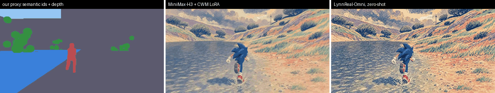
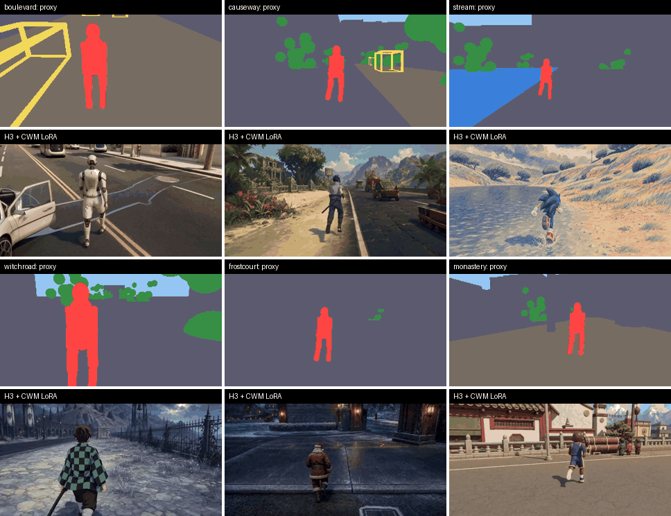
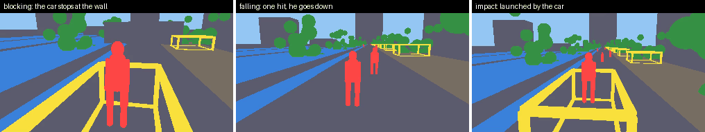
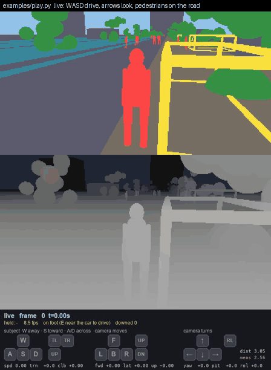

<div align="center">

<h1>Open Code World Model</h1>

<p><b>The proxy generator for <a href="https://github.com/buaacyw/code-world-model">Code World Model</a>: the half that wasn't released.</b></p>

<a href="https://github.com/buaacyw/code-world-model"></a> &ensp;
<a href="https://guangyiliu.com/open-code-world-model/gallery/"></a> &ensp;
<a href="https://github.com/TingtingLiao/streaming-code-world-model"></a> &ensp;
<a href="LICENSE"></a>

</div>

<br>



<div align="center"><sub>One scene, authored in code: he runs along the water's edge, then breaks right; the follow camera swings round behind him and the river leaves the frame. Left: the proxy this repository renders. Middle: MiniMax-H3 with the CWM LoRA reading it. Right: LynnReal-Omni reading the same proxy zero-shot.</sub></div>

---

[Code World Model](https://github.com/buaacyw/code-world-model) (Chen, Lin & Zhang, arXiv 2608.25927) drives a video model with a **proxy**: a per-frame stream of metric depth and semantic-class maps, authored by a coding agent, that tells the model where everything is. The paper releases the inference code, the CWM LoRA and 40 example proxies. It does not release the thing that *makes* proxies.

This repository is an independent implementation of that missing half: a scripted world simulator and CPU ray tracer that compile a scene into conditions in the released format, which MiniMax-H3 accepts unmodified.

> **⚡ Want it streaming?** The proxies from this repository are the control signal of
> [**streaming-code-world-model**](https://github.com/TingtingLiao/streaming-code-world-model):
> a causal, 4-step distilled MiniMax-H3 that renders each 0.71 s chunk from the start image, the
> proxy so far and the previous chunks, with no access to the future. 5.1 s per chunk on one H200,
> 9× faster than 35-step sampling and more accurate. Checkpoints are on
> [Hugging Face](https://huggingface.co/Luffuly/streaming-code-world-model).

## ✨ Highlights

- **Published-format conditions, no weights.** 336×192 metric depth + semantic ids at the measured 206.6 px focal length, 124-frame windows, captions compiled from the same simulation. A 484-frame take in ~25 s on CPU, in NumPy.
- **Drive it live.** `examples/play.py` is a GTA-style keyboard loop at 16 fps; the key log replays to full-quality conditions.
- **Physics the proxy knows about.** Solid walls, knockdowns and run-overs as opt-in rules; the caption names the act, the proxy shows the consequence.
- **Measured against the release, not assumed.** Camera intrinsics, the eight-class vocabulary and the two undocumented depth encodings were recovered from the 40 examples, with the scripts to re-derive them. [Measurements →](docs/measurements.md)
- **Results you can trace.** Every video below names the script that made it and the file it lives in. [Results →](docs/results.md)

## 📊 Results

### Does the LoRA read the proxy?

Six scenes, each anchored on a released first frame for its style; everything after frame 0 is ours. MiniMax-H3 generates each scene twice from the **same anchor, proxy, caption and seed**: in its native reference mode, and with the CWM LoRA. Both follow the caption. **Only the LoRA follows the proxy's camera and layout.** A third column gives the proxy to LynnReal-Omni zero-shot, which follows it at the same level.



| scene | what happens | proxy | H3 reference | H3 + LoRA | LynnReal-Omni |
|---|---|---|---|---|---|
| boulevard | walk; a shuttle halts; board; drive off | [▶](docs/gallery/video/boulevard_proxy.mp4) | [▶](docs/gallery/video/boulevard_nolora.mp4) | [▶](docs/gallery/video/boulevard_lora.mp4) | [▶](docs/gallery/video/boulevard_lynn.mp4) |
| causeway | run; a wagon passes; the boom pulls back | [▶](docs/gallery/video/causeway_proxy.mp4) | [▶](docs/gallery/video/causeway_nolora.mp4) | [▶](docs/gallery/video/causeway_lora.mp4) | [▶](docs/gallery/video/causeway_lynn.mp4) |
| stream | run along the river, break right | [▶](docs/gallery/video/stream_proxy.mp4) | [▶](docs/gallery/video/stream_nolora.mp4) | [▶](docs/gallery/video/stream_lora.mp4) | [▶](docs/gallery/video/stream_lynn.mp4) |
| witchroad | stop; the camera orbits 40°; walk on | [▶](docs/gallery/video/witchroad_proxy.mp4) | [▶](docs/gallery/video/witchroad_nolora.mp4) | [▶](docs/gallery/video/witchroad_lora.mp4) | [▶](docs/gallery/video/witchroad_lynn.mp4) |
| frostcourt | run and leap the curb, twice | [▶](docs/gallery/video/frostcourt_proxy.mp4) | [▶](docs/gallery/video/frostcourt_nolora.mp4) | [▶](docs/gallery/video/frostcourt_lora.mp4) | [▶](docs/gallery/video/frostcourt_lynn.mp4) |
| monastery | stop while the camera pushes in; run on | [▶](docs/gallery/video/monastery_proxy.mp4) | [▶](docs/gallery/video/monastery_nolora.mp4) | [▶](docs/gallery/video/monastery_lora.mp4) | [▶](docs/gallery/video/monastery_lynn.mp4) |

Made by `examples/gallery.py` (scenes) → `portb/run_cp.py` (H3, `--no-lora` for reference mode) and `examples/lynn_inputs.py` (LynnReal). Two 16-second takes generated the authors' way, and LynnReal-Omni streamed chunk by chunk with per-configuration timings, are on the [gallery page](https://guangyiliu.com/open-code-world-model/gallery/).

### Six released examples, reproduced

For six of the authors' examples we authored the scenario from their own prompt and generated video from their proxy and from ours, holding the anchor, caption and seed fixed. Placement tracks the proxy where the proxy matters (ex18, ex28); on a vista shot (ex34) the anchor and caption carry the shot and the proxy contributes little. We kept that one. `examples/repro.py`, panels in `docs/compare_ex*.png`, [page](https://guangyiliu.com/open-code-world-model/), [details](docs/results.md#1-six-released-examples-reproduced-end-to-end).

<p align="center"> </p>

### Physics, and driving it live



Three opt-in rules (`rules.physics()` in `world/rules.py`): **blocking** (walls and vehicles are solid; a walker stops 0.30 m from a face, a car one half-width), **falling** (one hit and a person goes down over 0.5 s) and **impact** (a vehicle above 2 m/s launches a standing person). `examples/moves.py` renders 29 single-control clips with the applied control read back from the render.

<p align="center"></p>

`examples/play.py`: WASD moves the subject relative to the view, arrows turn the view, E enters a car, Space jumps, F hits. 16 fps at 336×192 on a laptop; Esc writes the key log, and `--replay` turns it into published-format conditions through the same step function.

## 🚀 Quick start

```bash
git clone https://github.com/guangyliu/open-code-world-model && cd open-code-world-model
pip install numpy pillow                       # the generator needs only these two
python take_actions.py out/my_take             # 484 frames of depth + semantic ids, one caption per 124-frame window, ~25 s
```

```bash
python validate_conditions.py out/my_take/conditions   # independent cold re-read
python test_actions.py                                 # 29 scenario tests
python examples/gallery.py boulevard                   # one of the six gallery scenes
pip install pygame av && python examples/play.py       # drive it from the keyboard
```

**Feeding MiniMax-H3.** The conditions are drop-in for the official CWM inference path; `portb/run_cp.py` is the driver we use (PyTorch, safetensors, the released LoRA):

```bash
python portb/run_cp.py --conditions out/my_take/conditions --prompt-dir out/my_take/prompts \
    --anchor first_frame.png --windows 5 --steps 20 --tag my_take
```

Multi-window takes use the released 124-frame / 90-stride / 34-frame-overlap structure with the overlap pinned. `--pdd` merges the [PAI 8-step acceleration LoRA](https://huggingface.co/alibaba-pai/MiniMax-H3-Acc-LoRAs) alongside the CWM LoRA; on 4×H200 a window then takes about 88 s. For a model that streams, use [streaming-code-world-model](https://github.com/TingtingLiao/streaming-code-world-model).

## 📐 The condition format

| field | value |
|---|---|
| resolution | 336×192, pooled 2×2 from a 672×384 render |
| depth | float32 metres, first surface, 0 = no hit, near 0.3 m, far 256 m |
| focal length | 206.6 px (measured: IQR [204, 208] over 97 estimates, `inverse/focal_all.py`) |
| semantic ids | `0` other · `1` sky · `2` water · `4` road · `5` vegetation · `8` **the protagonist** · `9` animal · `10` vehicle |
| windows | 124 frames, stride 90, 34-frame overlap; one caption per window |

Three things the release does not document, all measured in [docs/measurements.md](docs/measurements.md): class 0 is a catch-all, not a ground plane; class 8 is "the protagonist", which is a stag in example 31; and 25 of the 40 examples store depth as uint16 log codes in a float32 array with a different 2×2 resample.

## 🧭 What the proxy supports, and what it does not

**Actions** (`world/actions.py`): approach-and-stop, halt, mount, ride, board, drive off, fly, descend, ballistic, knockdown, alight. **Entities**: human, vehicle, animal, vegetation, scenery, prop, water. **Camera**: follow, hold, orbit, push, pull, switchable per frame. **Captions** (`world/narrate.py`): compiled from the simulation, so they cannot drift from the geometry; `caption_sync.py` fails a take whose captions disagree with it. **Invariants**: finiteness, ground contact, motion continuity, mount pose and per-entity visibility are checked frame by frame; a take that violates one refuses to render.

Not yet: interiors (20 of the 40 released examples), crouch and kneel (24 of 40), articulated jumps and falls, the gray16 resample, more than one vegetation clump shape, and shots as wide as theirs (our camera hugs the action). Our primitives are about 20× worse than perfect geometry at the same camera; the measurement is in [docs/measurements.md](docs/measurements.md).

## 📁 Layout

```
compiler/      ray tracer, camera, primitives, condition encoding, rig
world/         entities, rules, actions, invariants, caption compiler, scene prose
examples/      gallery.py · repro.py · moves.py · play.py · lynn_inputs.py · jev_*.py
portb/         MiniMax-H3 driver (CWM LoRA, reference mode, PDD, multi-window retakes)
experiments/   lynnreal/: LynnReal-Omni driven chunk by chunk, and the drift measurement
inverse/       inverse-rendering probe of the released examples, and its findings
docs/          the gallery and example pages, their builders, the GIFs and videos above
take_actions.py · validate_conditions.py · caption_sync.py · test_*.py
```

## 🙏 Acknowledgements

Built on [Code World Model](https://github.com/buaacyw/code-world-model) and MiniMax-H3. This repository contains no code from CWM; the 40 released example conditions and prompts were the specification we measured the format against, and some scene prose derives from their released prompts (Apache-2.0, attributed in `NOTICE`). LynnReal-Omni results use [LynnReal-AI/LynnReal-Omni](https://github.com/LynnReal-AI/LynnReal-Omni). The streaming model is [Tingting Liao](https://github.com/TingtingLiao)'s.

## 📖 Citation

```bibtex
@article{chen2026cwm,
  title   = {Code World Model: Coding Agent as World Brain},
  author  = {Chen, Yiwen and Lin, Guosheng and Zhang, Chi},
  journal = {arXiv preprint arXiv:2608.25927},
  year    = {2026}
}

@misc{liu2026ocwm,
  title        = {Open Code World Model: a proxy generator for Code World Model},
  author       = {Liu, Guangyi},
  year         = {2026},
  howpublished = {\url{https://github.com/guangyliu/open-code-world-model}}
}

@misc{liao2026streamingcwm,
  title        = {Streaming Code World Model},
  author       = {Liao, Tingting and Liu, Guangyi},
  year         = {2026},
  howpublished = {\url{https://github.com/TingtingLiao/streaming-code-world-model}}
}
```
